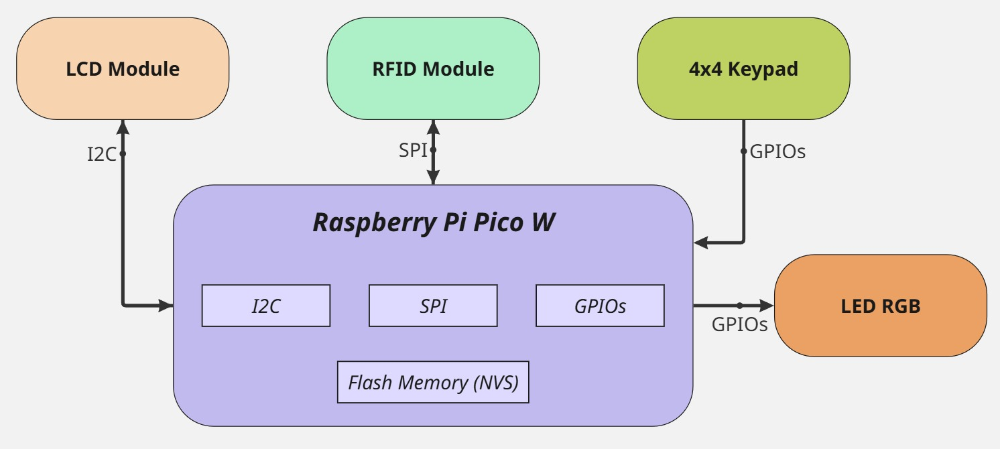
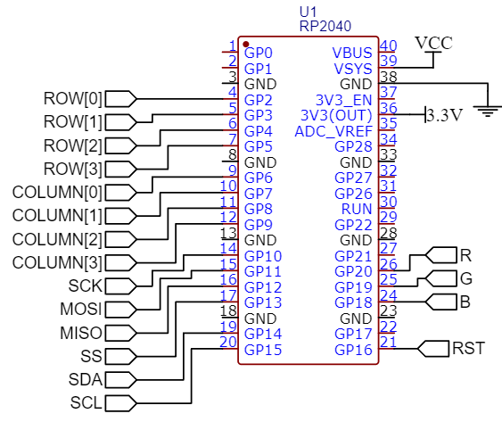

# Inventory Management System using RFID

A fully embedded system for **inventory tracking and control**, integrating **RFID technology**, a **matrix keypad**, and an **LCD display**.  
Designed for reliable warehouse management and real-time product monitoring using the **Raspberry Pi Pico W** platform.

<p align="center">
  
</p>

---

## 🧩 Overview

This project implements an **embedded inventory management system** capable of handling product entries and exits through RFID authentication.  
It combines modular firmware architecture with efficient hardware interfacing to achieve high reliability and scalability.

**Key Features:**
- RFID-based user and item identification  
- Secure administrative access  
- Real-time data visualization on a 16x2 I2C LCD  
- Persistent storage in non-volatile memory  
- Modular and interrupt-driven firmware design  

---

## ⚙️ Hardware Design

The system architecture is based on the **Raspberry Pi Pico W**, leveraging its GPIO, SPI, and I2C interfaces for peripheral control.

| Component | Function | Interface |
|------------|-----------|-----------|
| MFRC522 RFID Module | Reads item tags for identification | SPI |
| 4x4 Matrix Keypad | User input (authentication, transaction control) | GPIO (interrupt-driven) |
| 16x2 I2C LCD Display | Visual feedback for system status and inventory data | I2C |
| RGB LED | Indicates system states (tag detected, error, idle) | GPIO (PWM) |

### Connection Diagram
<p align="left">
  
</p>

Each peripheral is wired to ensure reliable communication and minimal pin usage.  
The design prioritizes simplicity, power efficiency, and robust signal integrity for embedded environments.

---

## 🧠 Software Design

The firmware follows a **modular structure**, separating low-level drivers from application logic.  
This allows easy debugging, scalability, and reuse across similar embedded projects.

### Main Software Modules

#### 🗃️ Inventory
Manages product data and transactions, storing them in flash memory.  
Includes methods for initialization, load/store operations, and system resets.

#### 🔢 KeyPad
Handles input events using interrupts and debouncing logic.  
Includes utilities for decoding key positions and managing user interaction.

#### 📶 NFC RFID
Controls the **MFRC522** reader via SPI.  
Implements low-level operations for tag detection, authentication, and data transmission based on the **ISO/14443-3** standard.

#### 💡 LiquidCrystal I2C
Controls the **16x2 LCD** display for user feedback.  
Implements character writing, screen clearing, and cursor positioning functions.

---

## 🧭 System Architecture

The system operates on a **Polling + Interrupt (IRQ)** hybrid model for responsive and deterministic behavior.


```sequence
[RFID Reader] --> [Raspberry Pi Pico W] <-- [Keypad]
                           |
                        [LCD Display]
                           |
                    [Flash Memory Storage]
```

---

## 🚀 Setup and Usage

### 1. Clone the repository
```bash
git clone https://github.com/MaverickST/Inventory_Management_RFID.git
```

2. Open in your development environment
Use VS Code (with Pico SDK) or Thonny.

3. Connect the hardware
Follow the wiring shown in the diagrams located in the /images or /docs folder.

4. Build and upload the firmware
Compile and flash the program to the Raspberry Pi Pico W using your preferred toolchain.

5. Operate the system
After powering up:

Use the keypad for user authentication and menu navigation.

Present an RFID tag to perform inventory transactions.

Monitor messages and feedback on the LCD display.

---

## 🧰 Tools and Technologies
- Raspberry Pi Pico W (RP2040)
- C language 
– Pico SDK
- MFRC522 RFID driver (SPI)
- HD44780 LCD controller (I2C)
- Modular embedded design principles

---

## 👥 Authors
Developed by:
- Maverick S. Tobón
- Cristian D. Araujo A.

## 📜 License

This project is released under the **MIT License**.  
See the [`LICENSE`](./LICENSE) file for details.
